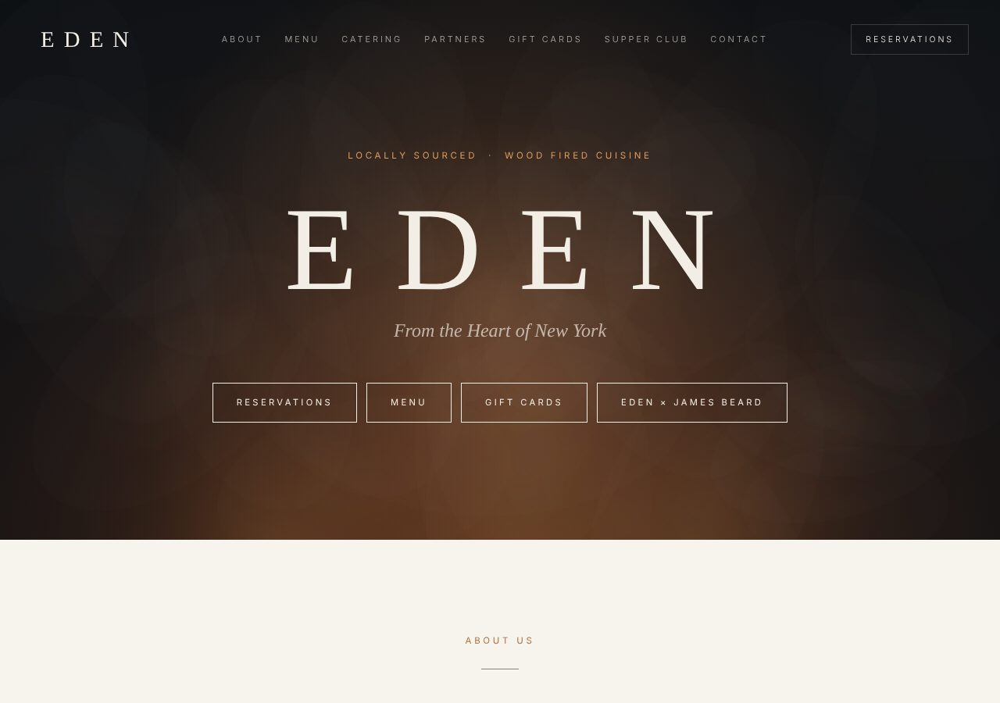
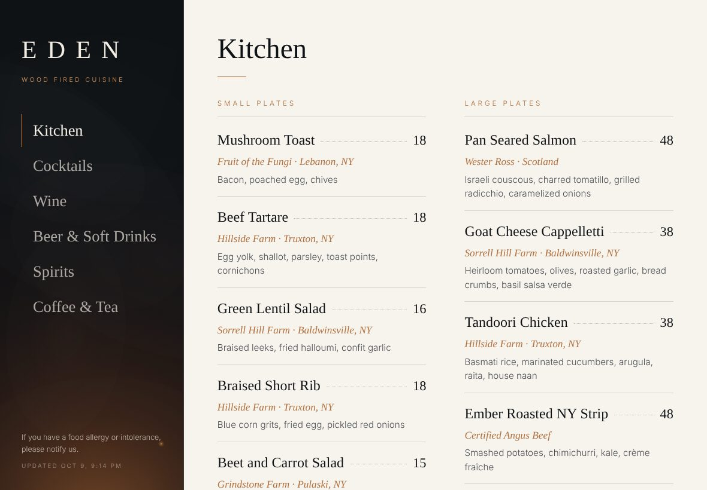
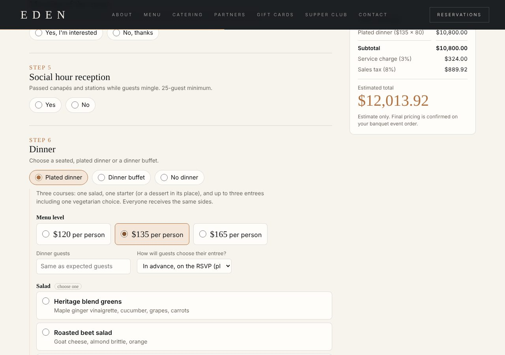

# Eden — Website, iPad Menu and Menu Editor

The website for **Eden**, an entirely wood-fired, farm-to-table restaurant at 118 E. Genesee St., Syracuse, NY. One project contains:

- **The website**: home page, About and team, the full food and drink menu, a 205-wine list you can browse several ways, Catering, Partners, Contact, and Supper Club and Catering sub-pages.
- **The iPad table menu**: a full-screen, touch-friendly menu for guests.
- **The menu editor**: change dishes, prices, wines and the Supper Club page. With a backend set up, changes appear on the website and the iPad menu within seconds.
- **The catering questionnaire**: a 10-step event planner with a live price estimate.



| iPad menu | Catering questionnaire |
|---|---|
|  |  |

---

## Technology

- **Plain HTML, CSS and JavaScript.** There is no framework, no build step and nothing to install. The site runs on any static web host, including GitHub Pages.
- **Google Fonts**: Cormorant Garamond and Jost, loaded from fonts.googleapis.com.
- **Node.js 18+ (optional)**: only for the helper scripts (local server, project check, rebuilding menu data). The website itself doesn't need Node.
- **Firebase (optional)**: Cloud Firestore and Firebase Authentication. These are needed only if you want live menu editing (see [Menu editor setup](#menu-editor-setup)). The Firebase SDK loads from Google's CDN only when that mode is turned on.

## Project structure

```
eden-website/
├── index.html                  The whole site (all pages are sections; routing uses #hash links)
├── css/styles.css              All styles
├── js/
│   ├── config.js               Settings: which menu backend to use, Firebase settings, editor emails
│   ├── runtime.js              Data layer: static / local / Firebase backends, file downloads, editor sign-in
│   ├── menu-data.js            The menu as a script (GENERATED from data/menu.json, don't edit by hand)
│   ├── country-maps.js         Map outlines and contour lines for the wine-list watermark
│   ├── catering.js             Catering questionnaire and price estimate
│   ├── app.js                  Everything else: navigation, menu, wine browsing, iPad menu, editor, animations
│   └── analytics.js            Anonymous visit counter for the staff site's Analytics page (no cookies)
├── data/menu.json              THE MENU: source of truth for food, drinks, wine list and Supper Club page
├── assets/
│   ├── images/                 Partner headshots
│   └── icons/eden-menu-icon.png  Home Screen icon for the iPad menu
├── firebase/
│   ├── firestore.rules         Database security rules (Firebase mode)
│   └── firebase.json           For deploying the rules with the Firebase CLI
├── scripts/
│   ├── serve.mjs               Local web server (npm start)
│   ├── build-menu-data.mjs     Rebuilds js/menu-data.js from data/menu.json (npm run build:menu)
│   └── check.mjs               Project health check (npm run check)
├── tools/event-questionnaire-staff.html   Original stand-alone questionnaire, including the staff
│                                          "open as BEO" tool (not linked from the public site)
├── docs/screenshots/           Images used in this README
├── .github/workflows/check.yml Runs the project check on every push
├── .nojekyll                   Tells GitHub Pages to serve files as they are
├── package.json
└── .gitignore
```

## Pages and links

All pages live in `index.html` and are opened with links that end in `#something`:

| Link | Shows |
|---|---|
| `/` | Home page |
| `/#supper` | Supper Club page (Eden × Friends of the James Beard Foundation) |
| `/#catering` | Catering page with the event questionnaire |
| `/#ipad` | iPad table menu (see [iPad menu](#ipad-menu)) |
| `/#editor` | Menu editor |

## Run it on your computer

Pick any one of these:

1. **Double-click `index.html`.** It opens in your browser and everything works, using the menu built into the project.
2. **With Node.js:** in the project folder, run `npm start`, then open http://localhost:8080.
3. **With Python:** in the project folder, run `python3 -m http.server 8080`, then open http://localhost:8080.

There are no dependencies to install. `npm install` isn't needed.

To check the project for missing files, broken links or code errors, run:

```
npm run check
```

## Publish it with GitHub Pages

1. Upload the project to a GitHub repository (see the steps at the end of this file).
2. In the repository, go to **Settings → Pages**.
3. Under **Build and deployment**, set **Source** to *Deploy from a branch*. Choose branch **main** and folder **/ (root)**, then click **Save**.
4. After a minute or two the site is live at `https://YOUR-USERNAME.github.io/REPOSITORY-NAME/`. The address appears at the top of the Pages settings.

**Custom domain (for example, edencny.com):** in **Settings → Pages → Custom domain**, enter the domain and click Save. Then, at your domain registrar, add the DNS records GitHub shows you. Turn on **Enforce HTTPS** once it's available. The domain currently points at the old Wix site, so switching it replaces that site.

Other static hosts also work as-is: drag the folder into Netlify Drop, or connect the repository to Cloudflare Pages or Vercel with no build command and `/` as the output folder.

## The menu

`data/menu.json` holds the menu, and `js/menu-data.js` is generated from it. After changing `data/menu.json`, run:

```
npm run build:menu
```

Then commit both files. (`npm run check`, and the GitHub check on every push, fail if they're out of sync.)

Each wine has `country`, `appellation` and `grape` fields, plus `bottle` and `glass` prices. These drive the wine list's **Browse by** views: Style, Country, Appellation, Grape, By the Glass and Bottles. Any item can carry `"hidden": true` to hide it without deleting it.

## Menu editor setup

The editor's behavior is set in `js/config.js` with `backend`:

| `backend` | What happens | Setup |
|---|---|---|
| `'static'` *(default)* | Read-only website. The menu comes from `data/menu.json`. The editor shows a "not connected" message, and the **Edit menu** link stays hidden. | None |
| `'local'` | The editor works, but saves only in the browser you're using. Other tabs in that browser update live. Use **Download menu.json** to export your edits. | None |
| `'firebase'` | Live editing for everyone. Changes appear on the website and every iPad within seconds. Editors sign in with email and password. | Free Firebase project (below) |

### Updating the menu without Firebase

1. In `js/config.js`, set `backend: 'local'` and open the site on your computer.
2. Go to `/#editor`, make your changes, then click **Download menu.json**.
3. Replace `data/menu.json` with the downloaded file and run `npm run build:menu`.
4. Set `backend` back to `'static'`, then commit and push. GitHub Pages republishes automatically.

### Live editing with Firebase (recommended for daily menu changes)

1. Go to https://console.firebase.google.com and click **Add project**. Google Analytics isn't needed.
2. **Build → Firestore Database → Create database.** Choose a location near Syracuse (for example `us-east4`) and start in **production mode**.
3. **Build → Authentication → Get started.** Under **Sign-in method**, enable **Email/Password**. Under **Users**, click **Add user** for each person who should edit the menu.
4. **Authentication → Settings → Authorized domains.** Add the domain the site will live on, for example `your-username.github.io` or `edencny.com`.
5. **Firestore Database → Rules.** Paste in the contents of `firebase/firestore.rules`, replace `editor@example.com` with your editors' emails, and click **Publish**.
6. **Project settings (gear icon) → General → Your apps.** Add a **Web app**, then copy its `apiKey`, `authDomain`, `projectId` and `appId` into `js/config.js`.
7. In `js/config.js`, set `backend: 'firebase'` and list the same editor emails under `editors`. Commit and push.
8. Open `/#editor`, sign in, and make any change. The first save copies the whole current menu into Firebase. From then on, the site reads the menu live from Firebase.

The Firebase web settings in `config.js` identify the project publicly. They aren't a password, and the security rules decide who can write. If Firebase can't be reached, the site quietly falls back to the built-in menu, so visitors always see a menu.

**Database layout** (identical in local mode):

```
site/menu               { allergy, updatedAt, tabs: [{ id, label, gids: [...] }] }
site/menu/groups/{gid}  { title, note, noteAfter, items: [...] }   one document per menu section
site/supper             Supper Club page content
```

Each menu section is its own document, so an edit only sends the section that changed.

## iPad menu

1. On the iPad, open the site in Safari and tap **Open iPad menu** at the very bottom of the page (or go to `/#ipad`).
2. Tap **Share → Add to Home Screen** and name it "Eden Menu."
3. From then on, that iPad always opens to the menu, with its own Home Screen icon.

- **Switching back to the website:** tap **EDEN** at the top of the menu's left column five times quickly.
- **Resetting for the next guest:** after 3 minutes without a touch, the menu returns to its first page.
- **Locking the iPad to the menu:** turn on **Guided Access** (Settings → Accessibility) so guests can't leave it.

## Catering questionnaire

The form runs entirely in the visitor's browser. Answers save on their device as they go, and the estimate uses the prices built into `js/catering.js`.

The catering page (`#catering`) is a short inquiry form: steps 1 and 2 (about you, your event). **Send inquiry** sends it to the staff site's **Catering & BEOs** page through the staff site's `/inquiry` address, where bots are screened out (Cloudflare Turnstile, only shown if it needs to check; a hidden field people never see; a too-fast check; limits per connection and email address; sanity checks). The Turnstile script and the check with the staff site load only on the catering page.

Our event team then emails the guest a private link, `#plan-<code>`, which opens the full questionnaire (all ten steps and the live estimate) with steps 1 and 2 already filled in. **Send my selections** sends everything back to the same inquiry; the guest can use the link again to make changes until the event becomes a BEO. Their answers also save in their browser as they go. Setup steps are in the eden-admin README (*Catering inquiries and email*).

If the staff site can't be reached, the short form offers to email the inquiry instead, and the full questionnaire falls back to saving a file to email to the addresses in `SEND_TO` at the top of `js/catering.js` (Tyler@edencny.com and Rich@edencny.com). Menus and prices are at the top of `js/catering.js`.

The original stand-alone questionnaire, including the staff-only **open these answers as a BEO** tool, is in `tools/event-questionnaire-staff.html`.

## Visitor statistics

`js/analytics.js` sends one small, anonymous note per page view (Home, Supper Club or Catering; the site the visitor came from; and any `utm_source` / `utm_medium` / `utm_campaign` tag on the link) to the staff site's `/t` address (`staffSite` in `js/config.js`, plus `t`). The staff site adds the approximate location and saves it for **Analytics → Website traffic**, which only the Owner can see. No cookies, nothing saved in the browser, no names or IP addresses. Browsers set to Do Not Track or Global Privacy Control aren't counted, and neither is the iPad menu or a copy running on your own computer.

Tip: tag the links you share so they show up by name, for example `https://edencny.com/?utm_source=instagram` in the Instagram bio or `?utm_source=newsletter` in an email.

## External services and dependencies

| What | Used for | Required? |
|---|---|---|
| Google Fonts (fonts.googleapis.com) | Typefaces | Yes. Without it, the site falls back to Georgia and Arial. |
| Firebase SDK 10.12.2 (www.gstatic.com) | Live editing | Only when `backend: 'firebase'` |
| Cloud Firestore and Firebase Auth | Live editing | Only when `backend: 'firebase'` |
| OpenTable, Square gift cards, partner websites | Outbound links | No, they're links only |
| Eden staff site (`/t`, `/inquiry`, `/plan`) | Anonymous visit counts; catering inquiries and questionnaires | No. If it can't be reached, visits aren't counted and the questionnaire falls back to email |
| Cloudflare Turnstile (challenges.cloudflare.com) | Bot check on the catering questionnaire | Only once switched on in the staff site; loads only on the catering page |

The project has no environment variables or API secrets, and none are committed.

## Known limitations

- **The wine-list watermark maps are simplified.** The country outlines and contour lines are hand-built approximations, and the region markers show general areas, not survey-accurate boundaries. A wine from a region not listed in `js/country-maps.js` shows the country outline without a marker. Add the region's coordinates there to fix it.
- **The iPad menu is a web app, not an App Store app.** It runs in Safari in full-screen mode.

## Upload this project to GitHub

**Without the command line:**
1. Sign in at https://github.com and click **New repository**. Name it (for example `eden-website`), choose Private or Public, and don't add a README. Click **Create repository**.
2. On the new repository's page, click **uploading an existing file**.
3. Open the unzipped `eden-website` folder, select **everything inside it**, and drag it onto the page. Hidden items like `.github`, `.gitignore` and `.nojekyll` may not show in your file browser. On a Mac, press **Cmd + Shift + .** to show them. If they still don't upload, use the command-line method instead.
4. Click **Commit changes**.

**With the command line:**

```
cd eden-website
git init
git add .
git commit -m "Eden website"
git branch -M main
git remote add origin https://github.com/YOUR-USERNAME/eden-website.git
git push -u origin main
```

Then follow [Publish it with GitHub Pages](#publish-it-with-github-pages). GitHub Pages on a private repository needs a paid GitHub plan. On a free account, make the repository public, or use Netlify or Cloudflare Pages, which work with private repositories.

---

© Eden, Syracuse NY. All rights reserved.
